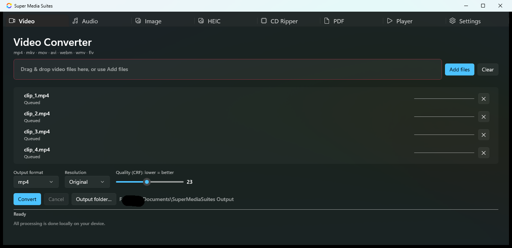
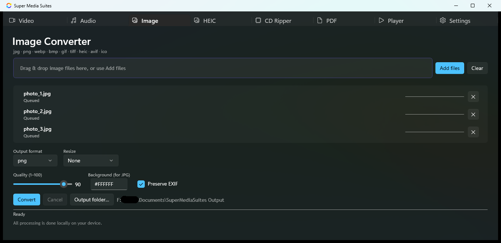

# Super Media Suites

**One window for all your everyday media chores.** Super Media Suites is a native Windows desktop
app (WinUI 3 / Windows App SDK, .NET 8) that bundles eight tools behind a tabbed shell: batch video,
audio, image and HEIC conversion, CD ripping, PDF work, a quick video player, and a settings page.
Everything runs **locally on your device** — no accounts, no ads, no telemetry, and every feature is
unlocked.

[](https://dotnet.microsoft.com/)
[](https://learn.microsoft.com/windows/apps/winui/winui3/)
[](#prerequisites)
[](LICENSE)
[](https://github.com/uponatime2019/SuperMediaSuites/releases/latest)





---

## Try it now — download

### [⬇︎ Download the latest release](https://github.com/uponatime2019/SuperMediaSuites/releases/latest)

Grab `SuperMediaSuites-vX.Y.Z-win-x64.zip`, unzip it anywhere (**no installer**), and run
`SuperMediaSuites.exe`. The zip is fully self-contained: it includes the .NET runtime and the Windows
App SDK, so **nothing needs to be installed** — not even a .NET runtime.

> Video, audio and CD ripping additionally use **ffmpeg**, which is deliberately not bundled (it is
> ~200 MB and separately licensed). Drop `ffmpeg.exe` + `ffprobe.exe` into an `ffmpeg\` folder next
> to `SuperMediaSuites.exe` — see [Enabling video, audio and CD ripping](#enabling-video-audio-and-cd-ripping).
> Image, HEIC and PDF conversion work out of the box.

---

## What's inside

| Tab | What it does |
|---|---|
| **Video** | Batch convert `mp4 · mkv · mov · avi · webm · wmv · flv` to `mp4 · mkv · webm · mov · avi`, with resolution presets (Original → 4K) and a CRF quality slider. |
| **Audio** | Batch convert `mp3 · wav · flac · aac · m4a · ogg · wma` to `mp3 · wav · flac · aac · ogg`, with bitrate selection and optional start/end trimming. |
| **Image** | Batch convert `jpg · jpeg · png · webp · bmp · gif · tiff · heic · heif · avif · ico` to `jpg · png · webp · bmp · gif · tiff · ico`, with resize (scale % or exact dimensions), quality and EXIF preservation. |
| **HEIC** | Turn iPhone `heic`/`heif` photos into `jpg`/`png`, with per-item thumbnails, quality control and EXIF options. |
| **CD Ripper** | Read the TOC of an audio CD and rip every track to `flac` or `mp3` 320 kbps, with an optional MusicBrainz metadata lookup and `Artist - Album` folder naming. |
| **PDF** | PDF → images (`png · jpg · tiff · gif · webp`, 96–600 DPI, page ranges), images → PDF (page size, orientation, password, compression), merge PDFs, and split PDFs by page range. |
| **Player** | Scan your Videos/Downloads folders (or any folder) and play a clip in the built-in player without leaving the app. |
| **Settings** | Default output folder, parallel job count (1–8), open-folder-after-conversion, minimize to tray, run at Windows startup, theme (System/Dark/Light), and version info. |

Every converter tab shares the same batch engine: drag files onto the window or use **Add files**,
watch per-item progress, cancel mid-run, and let it open the output folder when it finishes.

### Highlights

- **Batch everything** — the queue takes as many files as you like, processed with bounded
  parallelism (configurable, default 3) so conversions overlap without saturating the machine.
- **Drag & drop intake** on every converter tab.
- **Live progress** per file plus an aggregate progress bar and status line.
- **Cancellable** mid-batch, with per-item results (`Queued → Processing → Done` / `Failed: …`).
- **Tray integration** — optional close-to-tray, optional run at Windows login (starts hidden),
  left-click the tray icon to restore, right-click for Open/Exit.
- **Single instance** — launching the app again restores the running window instead of starting a
  second copy.
- **Local-only by design** — all processing happens on your device; the only network request the app
  can make is the optional MusicBrainz disc lookup on the CD Ripper tab.
- **Free and fully unlocked** — MIT licensed, no paid tier, no feature gates, no accounts, no ads,
  and no telemetry.

---

## Architecture

```
SuperMediaSuites/
├─ App.xaml(.cs)              entry point: logging, single-instance mutex, tray startup flag
├─ MainWindow.xaml(.cs)       8-tab TabView shell, tray icon, theme application
├─ Models/                    ConversionItem, CdTrack/CdDrive, VideoEntry, batch events
├─ Services/
│  ├─ ServiceLocator.cs       process-singleton services
│  ├─ AppSettings.cs          JSON settings in %LOCALAPPDATA%\SuperMediaSuites
│  ├─ Logging.cs              Serilog rolling daily files
│  ├─ BatchProcessor.cs       shared bounded-concurrency batch engine (cancellable, events)
│  ├─ FFmpegLocator.cs        finds ffmpeg.exe (app folder → LOCALAPPDATA → PATH)
│  ├─ CdRipper.cs             CD-ROM TOC + raw CDDA extraction via DeviceIoControl
│  ├─ MusicBrainzClient.cs    optional disc-id metadata lookup
│  ├─ StatusService.cs        bindable progress/status
│  ├─ StartupManager.cs       HKCU Run-key autostart for the unpackaged app
│  ├─ TrayService.cs          window subclassing, show/hide/restore
│  └─ ThemeHelper.cs          System/Dark/Light application to the root element
├─ Helpers/                   dispatcher helpers, pickers, drag/drop, thumbnails, format maps
├─ ViewModels/                one per tab (+ ConverterViewModelBase)
└─ Views/                     one UserControl per tab (XAML + code-behind)
```

**Patterns**

- **MVVM** via `CommunityToolkit.Mvvm` (`ObservableObject`, `[ObservableProperty]`,
  `[RelayCommand]`). `ConverterViewModelBase` owns the shared intake/queue/convert/cancel logic;
  Video, Audio, Image, HEIC and PDF derive from it.
- **Batch engine** — `BatchProcessor<TWork>` runs items with a `SemaphoreSlim`-bounded degree of
  parallelism, reports aggregate progress, honours a `CancellationToken`, and raises per-item
  `ItemCompleted`/`ItemFailed` events. All work happens on background threads; UI updates are
  marshalled back with `DispatcherQueue`.
- **Unpackaged-first** — the app is a plain portable executable (`WindowsPackageType=None`,
  `WindowsAppSDKSelfContained=true`). It never touches packaged-only APIs, so it runs from any
  folder — including a USB stick — without installation.

## Technology stack

| Layer | Technology |
|---|---|
| UI | WinUI 3 / Windows App SDK 2.4 (`TabView`, `InfoBar`, `MicaBackdrop`) |
| Language / runtime | C# 12 on .NET 8 (`net8.0-windows10.0.19041.0`), nullable reference types enabled |
| MVVM | CommunityToolkit.Mvvm 8.4 (source-generated properties and commands) |
| Video & audio | [ffmpeg](https://ffmpeg.org/) driven through Xabe.FFmpeg 5.2 |
| Images | Magick.NET (ImageMagick) 14.6 — conversion, resize, EXIF, HEIC/AVIF decoding |
| PDF | PdfSharpCore (assembly, merge, split) + PDFtoImage/PDFium + SkiaSharp (rasterizing) |
| CD audio | NAudio + raw `DeviceIoControl` CDDA reads |
| Tray icon | H.NotifyIcon.WinUI |
| Logging | Serilog + Serilog.Sinks.File (rolling daily files) |

---

## Prerequisites

**To run** the downloaded release: Windows 10 1809 (build 17763) or newer, x64. Nothing else — the
download is self-contained.

**To build** from source:

- Windows 10 1809+ / Windows 11
- .NET 8 SDK (or newer; the project back-targets `net8.0-windows`)
- Visual Studio 2022 17.8+ with the **.NET Desktop Development** and **Windows Application
  Development** workloads, *or* the equivalent SDKs on the command line

### Build

```bat
dotnet build SuperMediaSuites.csproj -p:Platform=x64
```

The project declares `x86;x64;ARM64`, so **a platform must be specified**. To build the standalone
portable folder exactly the way CI does:

```bat
dotnet publish SuperMediaSuites.csproj -c Release -p:Platform=x64 -o publish_out
```

### Run

```bat
dotnet run --project SuperMediaSuites.csproj -p:Platform=x64
```

Or open `SuperMediaSuites.sln` in Visual Studio, pick **Debug / x64**, and press <kbd>F5</kbd>.

## Enabling video, audio and CD ripping

The Video, Audio and CD Ripper tabs encode with **ffmpeg**, which is never downloaded at runtime.
Place the binaries next to the project (or next to `SuperMediaSuites.exe` in a release build):

```
Super Media Suites\
    ffmpeg\
        ffmpeg.exe
        ffprobe.exe
```

`FFmpegLocator` searches, in order:

1. `<app folder>\ffmpeg\` (or `<app folder>\` itself, and any subfolder)
2. `%LOCALAPPDATA%\SuperMediaSuites\bin\`
3. Your `PATH` (`ffmpeg.exe` + `ffprobe.exe` in the same folder)

If none is found the app still starts and the Image/HEIC/PDF tabs keep working; the affected tabs
report *"ffmpeg.exe was not found"* per item and a warning bar appears above the status line with a
**Recheck** button. Static builds: <https://www.gyan.dev/ffmpeg/builds/> or
<https://github.com/BtbN/FFmpeg-Builds>. Note that ffmpeg builds are usually GPL-licensed — check
the terms of the build you download before redistributing it.

## Keyboard and interaction reference

| Input | Where | Action |
|---|---|---|
| <kbd>Tab</kbd> / <kbd>Shift</kbd>+<kbd>Tab</kbd> | Everywhere | Move focus forward / backward |
| <kbd>←</kbd> <kbd>→</kbd> | Tab strip (when focused) | Switch between the eight tool tabs |
| <kbd>↑</kbd> <kbd>↓</kbd> | File queue, format and bitrate lists | Move through the list |
| <kbd>Enter</kbd> / <kbd>Space</kbd> | Focused button, toggle or combo | Activate / open / toggle it |
| <kbd>Alt</kbd>+<kbd>F4</kbd> | Main window | Close — minimizes to the tray when *Minimize to tray* is on, otherwise exits |
| Left-click tray icon | Notification area | Restore and focus the window |
| Right-click tray icon | Notification area | **Open App** / **Exit** |
| Drag & drop | Any converter tab | Add files to the queue (file types are filtered per tab) |
| **Add files** / **Clear** | Any converter tab | Pick files with the Windows picker / empty the queue |
| **✕** on a row | File queue | Remove that file from the queue |
| **Output folder…** | Any converter tab | Choose a destination folder (rows are otherwise written next to the source file) |

The app has no hidden modifier-key shortcuts by design — every action is reachable from the visible
UI, which keeps it usable with screen readers and on tablets.

## Logs, settings and where files go

| What | Where |
|---|---|
| Logs | `%LOCALAPPDATA%\SuperMediaSuites\Logs\*.log` (rolling daily, 14 days retained) |
| Settings | `%LOCALAPPDATA%\SuperMediaSuites\settings.json` |
| Default output | `%USERPROFILE%\Documents\SuperMediaSuites Output` (configurable in Settings) |
| Autostart entry | `HKCU\Software\Microsoft\Windows\CurrentVersion\Run\SuperMediaSuites` (only if you enable *Run at Windows startup*) |
| CD rip temp files | `%TEMP%` (deleted as each track finishes) |

If the app misbehaves, the log file is the fastest way to find out why — attach it to your issue.

---

## Roadmap

**Short term**

- [ ] Bundle a download helper/one-click ffmpeg setup so the video and audio tabs work out of the box
- [ ] GPU-accelerated encoding (`h264_nvenc` / `h264_qsv` / `h264_amf`) when the hardware supports it
- [ ] Per-file output-folder overrides and a persisted conversion history
- [ ] Drag-to-reorder the queue, plus save/load a queue as a preset
- [ ] Video trimming and audio-normalization options on the Video/Audio tabs

**Medium term**

- [ ] Subtitle handling: embed, extract and burn-in `.srt`/`.ass` tracks
- [ ] Image comparison (before/after slider) and lossless JPEG re-compression
- [ ] OCR text extraction in the PDF tab, plus PDF page rotation and basic compression
- [ ] CUE sheet + AccurateRip-style verification for the CD Ripper
- [ ] Directory-watch "auto-convert new files in this folder" mode

**Longer term / nice to have**

- [ ] Windows 11 taskbar jump lists with recent conversions and quick actions
- [ ] ARM64 release builds alongside x64
- [ ] A plugin-style tool host so new converters can be added without touching the shell
- [ ] Localization (the UI strings are currently English-only)
- [ ] Command-line mode (`SuperMediaSuites.exe --convert …`) for scripting and automation

Have a feature you want? [Open an issue](https://github.com/uponatime2019/SuperMediaSuites/issues)
— roadmap items are picked by demand, and PRs are very welcome.

---

## Contributing & community

Contributions of every size are welcome — bug reports, feature ideas, docs fixes, and code. The full
guide lives in [CONTRIBUTING.md](CONTRIBUTING.md); the short version:

- 🐞 **Found a bug?** [Open an issue](https://github.com/uponatime2019/SuperMediaSuites/issues/new)
  with your Windows version, the app version and the log file. That is usually enough to fix it.
- 💡 **Have an idea?** Open an issue describing the workflow you are trying to improve — use cases
  beat feature lists.
- 🔧 **Want to code?** Fork the repo, create a topic branch, keep the change focused, make sure
  `dotnet build SuperMediaSuites.csproj -p:Platform=x64` is clean, and open a pull request
  describing how you tested it.
- ⭐ **Just like it?** Starring the repo helps other people find it — and it is genuinely motivating.

This project is a friendly, single-maintainer space. Please be kind, assume good faith, and remember
that everyone here is volunteering their time.

## License

[MIT](LICENSE) © 2026 uponatime2019 — do what you like with it, no warranty.

Third-party components keep their own licenses (Windows App SDK, CommunityToolkit.Mvvm, Magick.NET,
PdfSharpCore, PDFtoImage, SkiaSharp, NAudio, Xabe.FFmpeg, H.NotifyIcon, Serilog). ffmpeg is **not**
included in this repository or in the release zip.
