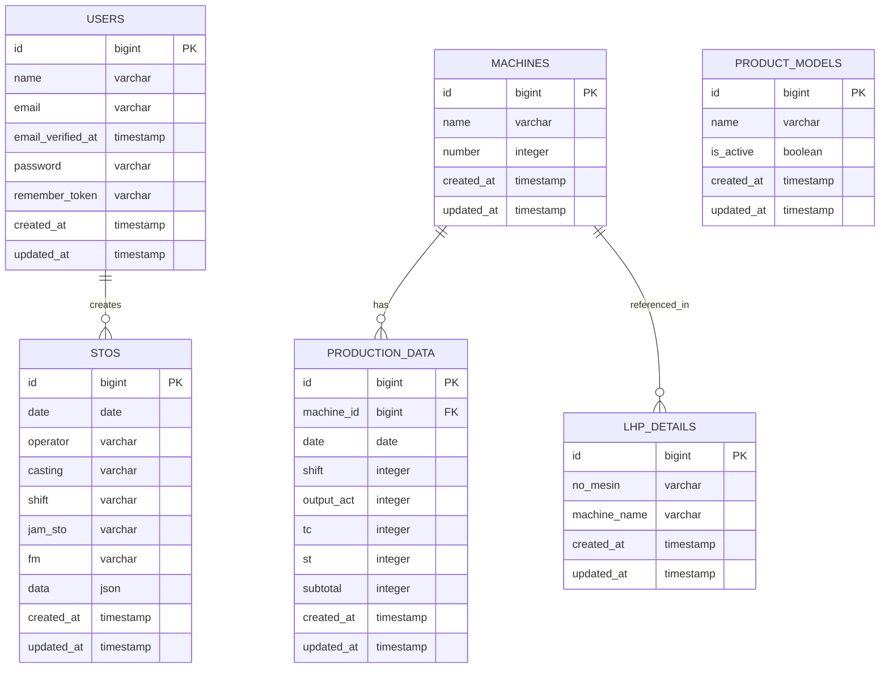
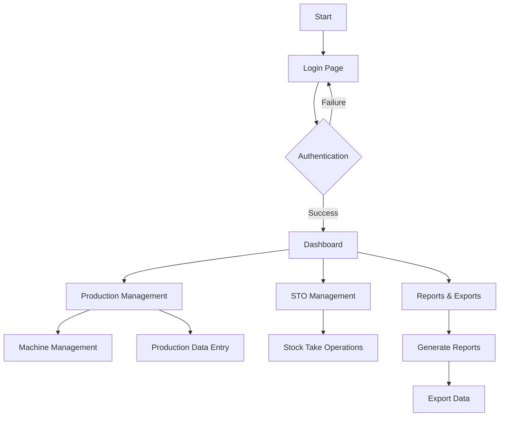
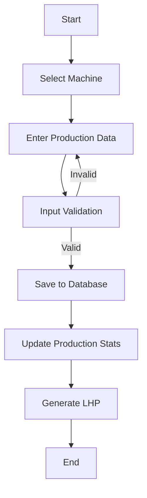
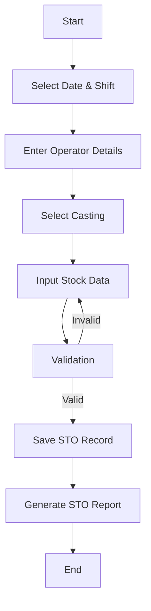

# Production Management System Documentation

## 1. Project Overview

This is a Laravel 11-based production management system designed to handle manufacturing operations, including machine management, production tracking, and stock operations. The system provides comprehensive features for managing production data, generating reports, and monitoring manufacturing processes.

### Technology Stack
- Backend Framework: Laravel 11
- Database: MySQL
- Frontend: Blade templates with Tailwind CSS
- Authentication: Laravel built-in authentication

### Key Features
- User Authentication and Management
- Production Data Tracking (LHP - Laporan Hasil Produksi)
- Stock Take Operations (STO)
- Machine Management
- Product Model Management
- Multiple Export Formats
- Real-time Production Monitoring

## 2. Database Schema (ERD)



## 3. System Architecture

### Directory Structure
```
laravel-11-mysql/
├── app/
│   ├── Exports/               # Export functionality
│   │   ├── Casting1Export.php
│   │   ├── Casting2Export.php
│   │   ├── CombinedExport.php
│   │   ├── CumulativeExport.php
│   │   └── StoExport.php
│   ├── Http/
│   │   └── Controllers/       # Application logic
│   │       ├── Auth/         # Authentication controllers
│   │       ├── LhpController.php
│   │       ├── PageController.php
│   │       ├── ProductModelController.php
│   │       ├── StoController.php
│   │       └── UserController.php
│   └── Models/               # Database models
│       ├── Machine.php
│       ├── ProductionData.php
│       ├── ProductModel.php
│       ├── Sto.php
│       └── User.php
├── resources/
│   └── views/               # Blade templates
│       ├── auth/           # Authentication views
│       ├── components/     # Reusable components
│       ├── layouts/       # Layout templates
│       ├── dashboard.blade.php
│       ├── lhp.blade.php
│       └── sto.blade.php
```

## 4. Process Flows

### Main User Flow


### Production Data Flow


### STO Process Flow


## 5. Feature Details

### Authentication System
- Secure login/registration system
- Password reset functionality
- Email verification
- Remember me functionality
- Session management

### Production Management
- Machine registration and tracking
- Production data entry and monitoring
- Real-time production statistics
- LHP (Laporan Hasil Produksi) generation
- Historical data tracking

### Stock Take Operations (STO)
- Stock level monitoring
- Operator assignment
- Shift-wise stock tracking
- JSON-based flexible data storage
- Report generation

### Export Functionality
- Multiple export formats
- Casting-specific exports
- Combined data exports
- Cumulative reports
- STO reports

### User Interface
- Responsive design
- Intuitive navigation
- Data visualization
- Real-time updates
- Mobile-friendly layout

## 6. Security Considerations

### Authentication
- Secure password hashing
- CSRF protection
- Session management
- Rate limiting

### Data Protection
- Input validation
- SQL injection prevention
- XSS protection
- CORS policies

### Access Control
- Role-based access
- Route protection
- Resource authorization
- API authentication

## 7. Error Handling

### Types of Errors
- Authentication errors
- Validation errors
- Database errors
- System errors

### Error Management
- Detailed logging
- User-friendly error messages
- Error tracking
- Recovery procedures

## 8. Testing

### Test Types
- Unit tests
- Feature tests
- Integration tests
- Browser tests

### Testing Procedures
- Automated testing
- Manual testing
- Regression testing
- Performance testing
